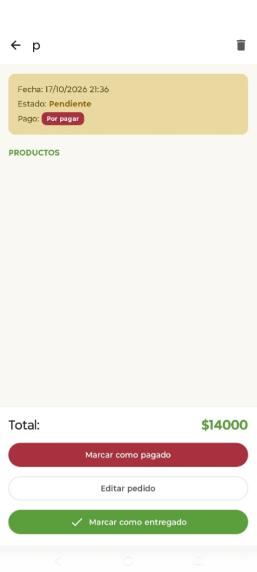

# Bugs Reportados y Resueltos — La Mejor Caserita

## Resumen
Durante las pruebas en producción, se detectaron 3 bugs críticos que afectaban la integridad de los datos y la estabilidad de la app. Todos fueron documentados, diagnosticados y resueltos.

---

### BUG-001 — Cálculo incorrecto del total al editar un pedido
- **Severidad:** Crítica
- **Descripción:** Al editar un pedido y agregar productos, la suma total mostraba un valor erróneo (ej: mostraba $3.300 en lugar de $4.300). Los productos se guardaban, pero el total se desincronizaba.
- **Causa raíz:** La tabla de la base de datos retenía estados anteriores de los subtotales al hacer actualizaciones asíncronas.
- **Solución:** Se reescribió la función `actualizarPedido` para que elimine todos los items anteriores y reescriba la lista exacta con los subtotales recalculados desde cero.
- **Evidencia:**

| Captura 1 | Captura 2 |
| :---: | :---: |
|  |  |

### BUG-002 — Cierre inesperado (Crash) al usar el reconocimiento de voz
- **Severidad:** Alta
- **Descripción:** Si el usuario presionaba "atrás" mientras el micrófono estaba escuchando, la app se cerraba abruptamente.
- **Causa raíz:** El `SpeechRecognizer` intentaba actualizar la UI de una pantalla que ya había sido destruida.
- **Solución:** Se agregó el método `reconocimientoVoz.cancelar()` dentro del `DisposableEffect` en el ciclo de vida `onDispose`.

### BUG-003 — Desaparición momentánea de la lista de productos al editar
- **Severidad:** Media
- **Descripción:** Al presionar "Guardar cambios", la lista de productos parpadeaba o desaparecía por un segundo.
- **Causa raíz:** Un `LaunchedEffect` mal configurado reiniciaba el estado de "cargando" cada vez que la lista de productos se refrescaba.
- **Solución:** Se ajustó el `LaunchedEffect` para que solo escuche los cambios en el `pedidoId` y no en la lista de productos.
- **Evidencia:**

| Captura del error |
| :---: |
|  |